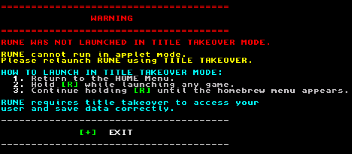
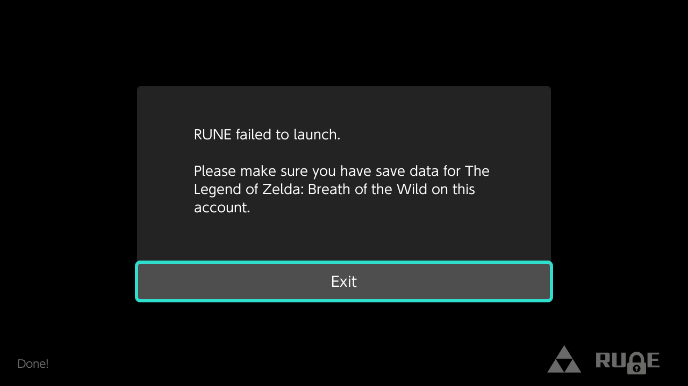
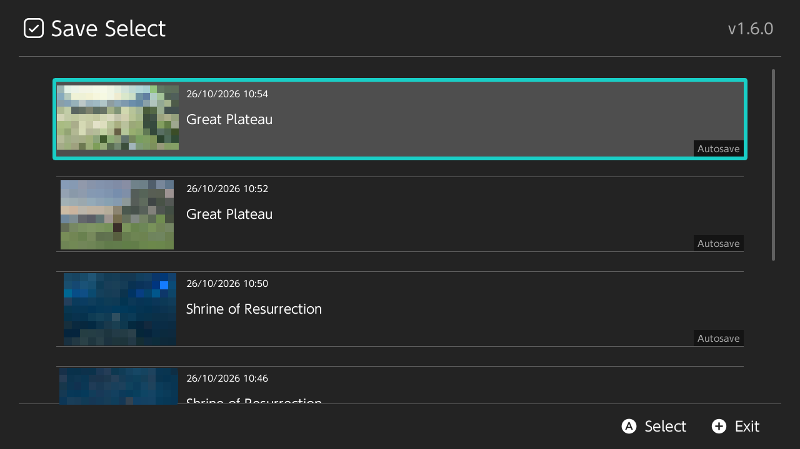
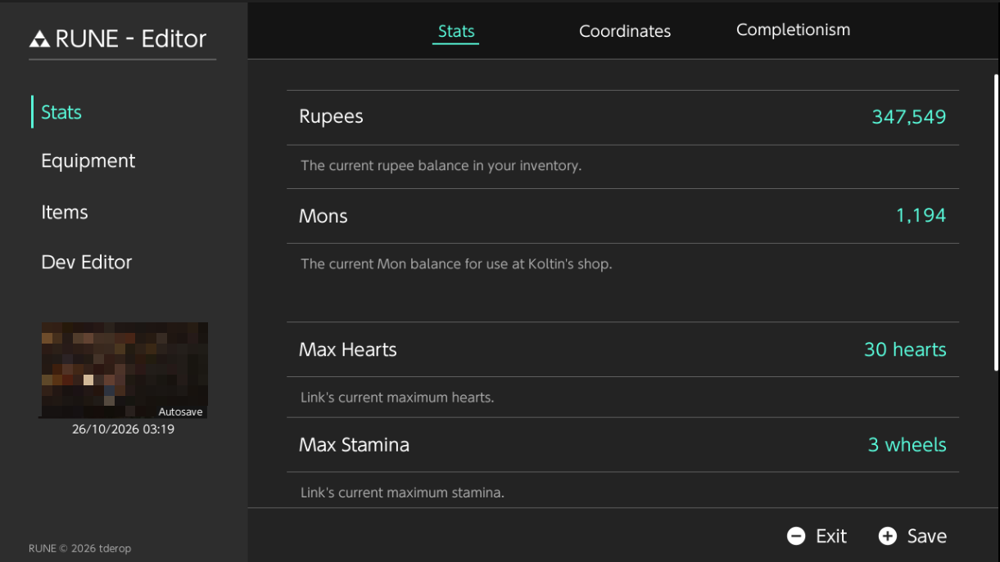
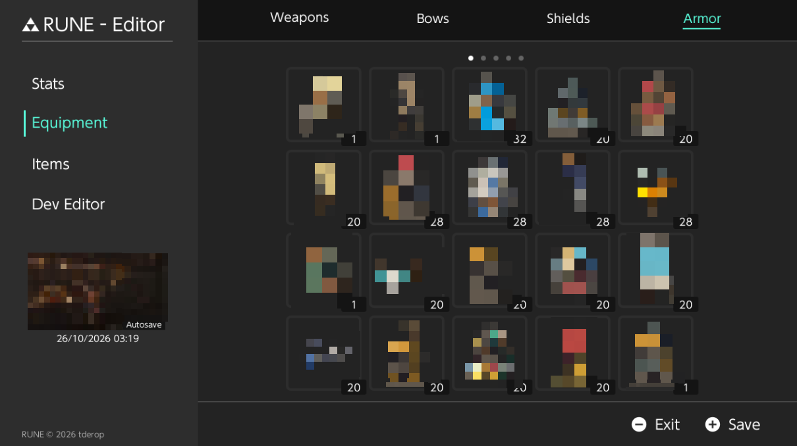
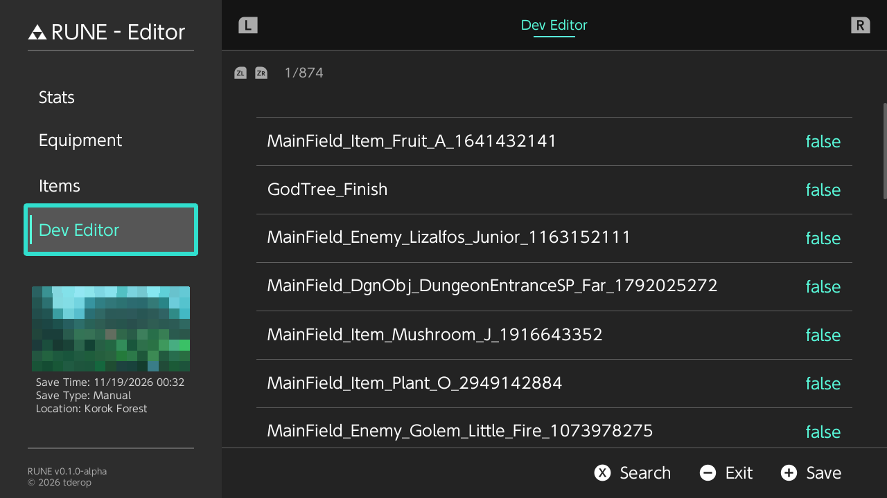

# RUNE User Guide
Thank you for using RUNE, instructons on how to install and use it are all listed for you below. Happy save editing!

## Installation
> [!NOTE]
> Atmosphére custom firmware is required to run homebrew software like RUNE on your Nintendo Switch. For information on how to install Atmosphére, please visit [switch.hacks.guide](https://switch.hacks.guide/) and follow the guides.

1. Download the latest standalone `.nro` release of RUNE
2. Copy `RUNE.nro` to `sdmc:/switch/RUNE.nro` on your Nintendo Switch's SD card
3. Boot into Atmosphére
4. Click on a game to launch it, and hold R whilst you select a user
5. Continue holding R until the **hbmenu** appears, then select RUNE

You're now running RUNE on your Nintendo Switch!

### Why don't I see icons in RUNE?
Because of copyright law, RUNE is not allowed to redistribute content owned by Nintendo Co., Ltd., which includes the item icons you see in your inventory.<br><br>Fortunately, this doesn't mean you _can't_ have icons, it just means you need to **open RUNE in "title takeover" mode** with Breath of the Wild selected. **This takes time**, on average about 1 minute and 30 seconds. You only need to do this once.<br><br>By doing this, you give RUNE access to the files in your local Breath of the Wild installation - allowing it to extract the menu icons to your SD card. The icons are cached in `sdmc:/switch/RUNE/assets/thumb`; take a look - they're extracted from your own copy of the game! All of the icons combined should take up a total of no more than ~40MB of space. You're responsible for keeping these on your own device! Redistributing these assets to anyone else is a violation of copyright law.
<br>

>[!NOTE]
>For the assets to extract successfully, your SD card needs to have **at least 60MB of free space**. If you follow the steps above and RUNE does not start extracting assets, please ensure there is enough free space on your SD card.

## Usage and Troubleshooting

### Launching
When launching RUNE, you need to launch it in **title takeover** mode. If you don't, you may get this old-looking error:



This means you launched RUNE through the Album applet. RUNE cannot run in applet mode, as it does not provide enough resources for RUNE to run stably. Follow the on-screen instructions and your issue should be resolved.

### Loading
During load, RUNE shows a logo and provides some information on the loading progress in the bottom left. It's likely this succeeds and RUNE loads successfully, however you could encounter this error:



This means RUNE either failed to access your Breath of the Wild save data, or the account that you opened RUNE with does not have any save data for Breath of the Wild yet. In this case, you need to open the game on the account you desire to use, and then ensure there is at least one save slot before re-opening RUNE. 

### Editing a Save
After launching RUNE, you will see a save select menu, similar to the in-game one.



In the top right, the version number is the **version of your game save** (more specifically the version of the save slot at index 0, as save version can vary between slots...)

Selecting a save will open the editor. If the editor fails to load - or crashes RUNE - it is possible that the selected save slot is corrupted or unsupported.

The editor looks something like this:



In the stats tab, you can edit a few common values. Clicking on any of the options here will open an overlay that will let you edit the value. Some overlays will show a **question mark** (?) button in the top left. When clicked, these buttons will display extra information on screen to explain some details about the value you're modifying.

If you would like to request more values to be shown on these pages, please open an [enhancement issue](https://github.com/tderop/RUNE/issues/new). Simple values like these are easy to implement editors for. 

You can use L and R to navigate between top menus (Stats, Coordinates and Completionism in this case.)

The equipment and items tabs open menus that looks like this:



It is designed to look similar to the in-game equipment inventory. In this case, however, clicking on an item opens an overlay that will provide you with a list of properties you can edit.
These properties range from durability, to modifier, to armor upgrade level, to dye colour, and more. Some modifiers will show a "modifier value" editor, as these modifiers require a value to know "how much" to modify the equipment.

You can navigate pages in inventory menus using the right stick.

>[!IMPORTANT]
>When you're editing an inventory item, you have the option to "swap" the item in that slot. This shows a list of other items you can select to replace the currently selected item with. Please note that **not every item in these lists** has been tested to work, so if you find an item that doesn't, please [open an issue](https://github.com/tderop/RUNE/issues/new).

The final tab is the **Dev Editor**. Only use this one if you **know what you are doing**. It is designed to let you edit any value in save data freely, acting as a simple middleman between you and the save file's raw binary data. **Modifying values here could result in a corrupted state / softlocked save**; it is entirely designed for people that know what they are doing, or just want to mess around with a save file they don't particularly care about.



You can search this tab using "X", which will open a keyboard for you to type a search query. If your search matches no keys in save data, the menu will just display all available keys, like above.

Any changes you make to the save file through any of the menus **are not saved until you press PLUS (+) in the main editor menu**; if anything goes wrong or you don't want to save your staged changes, just press **MINUS (-)** and all of your changes will be discarded.

### Loading Backups
Currently, RUNE does not have a built in feature to allow restoring backups. This is a planned feature and will be released later. For now, to load a backup, you must follow these steps:

*On your PC*
1. Access your Nintendo Switch's SD card
2. Navigate to `sdmc:/switch/RUNE/backups`, and select the backup `.sav` you wish to restore
>The naming format for these backups is `game_data.sav.BAK_DD.MM.YYYY_HH.MM` to help you identify which backups are which.
3. Rename the backup to `game_data.sav`

*On your Nintendo Switch*
1. Open [JKSV](https://github.com/J-D-K/JKSV)
2. Navigate the Breath of the Wild's title icon, click it, then click `New Backup`
3. Wait for the backup to fully complete

*On your PC*
1. Access your Nintendo Switch's SD card
2. Navigate to `sdmc:/JKSV/The Legend of Zelda Breath of the Wild/`
3. Copy the backup you just made over to your PC, and extract it
4. Navigate to the save slot you want to replace with the backup 
> Save slots are listed as folders named 0 → 7, with slots 0 → 5 representing your normal mode saves, and 6 → 7 representing your master mode saves. To differentiate between slots, you can preview the `caption.jpg` image in the slot folder.
5. Move the renamed backup into the folder, and confirm replacing files with the same name
6. Compress the save folder to a `.zip`
> So the structure of the zip looks like this:
```
file.zip/
├── 0/
│   ├── caption.jpg
│   ├── caption.sav
│   └── game_data.sav
├── 1/
│   ├── caption.jpg
│   ├── caption.sav
│   └── game_data.sav
├── (Slots 2 → 7)...
│
├── album/
│   ├── pict_000.jpg
│   └── ...
├── pict_book/
│   ├── Animal_Cassowary_A.jpg
│   └── ...
├── tracker/
│   ├── trackblock00.sav
│   └── ...
└── option.sav
```
7. Name the `.zip` archive something memorable, and move it to `sdmc:/JKSV/The Legend of Zelda Breath of the Wild/`

*On your Nintendo Switch*
1. Open JKSV and select Breath of the Wild (ensure the correct account is selected too)
2. Navigate to and hover over the `.zip` archive you just created, and press **Y** to restore
3. Hold **A** to confirm restoration, and wait for it to complete

Sorry this is a bit of a headache. Hopefully you will not need to reload backups, but for now, this method is here just in case something goes wrong (and as I mentioned, a built in backup restoration feature is planned.)