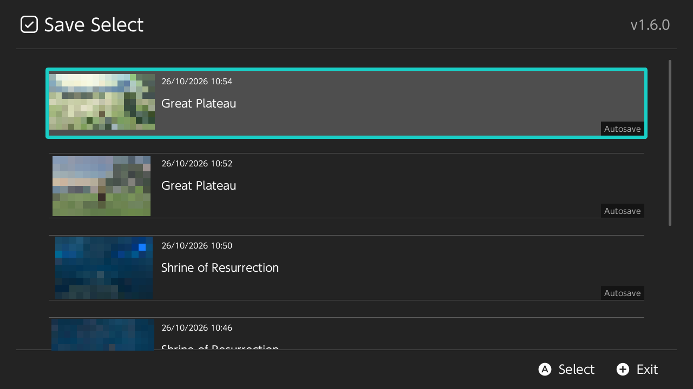

<h1>RUNE - Native NX GUI Save Editor for BotW</h1>


[](https://github.com/tderop/RUNE/releases/latest)
[](https://somsubhra.github.io/github-release-stats/?username=tderop&repository=RUNE&page=1&per_page=300)


**RUNE** is an **unofficial**, free and source-available native GUI save editor for The Legend of Zelda: Breath of the Wild on Nintendo Switch.

RUNE is currently in early access, meaning you are highly likely to encounter bugs. Please open issues when you find them.

> [!CAUTION]
> Since RUNE is early access, you use it at your own risk. Please make backups before editing valuable saves. [JKSV](https://github.com/J-D-K/JKSV) is an incredible native save manager for Atmosphére.

## Installation
Please refer to <a href="GUIDE.md#installation">the User Guide</a> for information on how to set up RUNE for the first time.

## Screenshots
> [!NOTE]
> Game screenshots/icon assets have been omitted/pixelated in these screenshots. RUNE features support for full resolution save slot thumbnails and item icons.

<table>
    <tr>
        <td></td>
        <td></td>
    </tr>
    <tr>
        <td></td>
        <td></td>
    </tr>
</table>

## Known Issues and Feature Gaps
### Food is Not Fully Supported
Currently, RUNE does not support modifying the properties of meals such as health recovery or buff type/duration. This feature is planned for a later release. Elixirs default to the ice cream icon (as this is the base icon for Elixirs in the game files.)

### Quick Shot Modifier is Confusing for Users
Currently if you select the quick shot modifier from the modifier dropdown menu, it'll just show a modifier value editor with a seemingly random number. Usually it'll be ~1,200-1,300 for game-generated quick shot bows. From my own testing this seems to be a speed multiplier (e.g. 1,200 = 1.2x, or +20%, speed), and is limited at high values (around 4,000+) by the speed of the initial windup animation.

### Array Values Cannot be Edited Through Dev Editor
Array values (such as PorchItem, PorchItem_Value1, AlbumSaveDistrictName...) cannot be modified through the dev editor, as widgets for array-type values do not exist yet. These may be added in the future.

## Building from Source

### Prerequesites
Ensure you have the following installed on your system:
- devkitPro (with devkitA64 "Switch Development" installed)
- Open MSys2 and Install required portlibs:
```bash
pacman -S \
    switch-sdl2 switch-sdl2_ttf switch-sdl2_image switch-sdl2_gfx switch-sdl2_mixer \
    switch-mesa switch-libdrm_nouveau \
    switch-freetype switch-libpng switch-libjpeg-turbo switch-libwebp \
    switch-harfbuzz switch-bzip2 switch-zlib \
    switch-libvorbisidec switch-libmodplug switch-mpg123 switch-libogg 
```

### Build Steps
- Clone the repository:
```bash
git clone https://github.com/tderop/RUNE && cd RUNE
```

- Compile to `.nro`:
```bash
make
```

> Once compiled, the output `.nro` can be found in the `output` directory.

- Clean build artifacts:
```bash
make clean
```

## Credits
Thanks to:
- Random Penguin (@Random-Penguin) for participating in closed QA testing
- ZeldaMods for save file information found at https://zeldamods.org/wiki/Save_Files
- MrCheeze for `actor_names.json`, a part of the botw-tools repository https://github.com/MrCheeze/botw-tools/
- Léo Lam (@leoetlino) at ZeldaMods for
    - The bymlplus library for parsing BYAML files: https://github.com/zeldamods/bymlplus (used for metadata generation)
    - oead - `oead::yaz0` source used for helping me understand the yaz0 compression format: https://github.com/zeldamods/oead
- KillzXGaming for
    - Switch Toolbox used for helping me understand the SBITEMICO format: https://github.com/KillzXGaming/Switch-Toolbox
    - BfresLibrary used for helping me understand the BFRES format: https://github.com/KillzXGaming/BfresLibrary
- Tyulis for documenting BNTX and BRTI: https://github.com/Tyulis/3DSkit/blob/master/doc/BNTX.md
- AboodXD (@aboood40091) for:
    - BNTX-Injector source https://github.com/aboood40091/BNTX-Injector ...
    - ... which also directed me to the NVIDIA Tegra X1 Mobile Processor (Technical Reference Manual) page 1215-1240 - Chapter 20: Pixel Memory Format
- tallbl0nde for the WIP Aether UI library: https://github.com/tallbl0nde/Aether
- Sean Barrett (@nothings) for `stb_image_write.h` for writing PNG files to disk
- devkitPro for the devkitA64 toolchain
- switchbrew for the libnx library: https://github.com/switchbrew/libnx
- and the Atmosphére team

for making RUNE possible!

## Version Information
RUNE was tested and verified to work on the following firmware version(s)
- 20.5.0
- 21.0.0
- 22.1.0

The following Atmosphére version(s)
- 1.12.0 | EmuMMC
- 1.12.1 | EmuMMC
- 1.12.2 | EmuMMC

The following BotW version(s)
- 1.1.0
- 1.5.0
- 1.6.0
- 1.9.0

and the following platform(s)
- Nintendo Switch
- Ryujinx Emulator

> [!NOTE]
> As Ryujinx cannot launch games with title takeover mode, RUNE on Ryujinx cannot extract icons from your Breath of the Wild installation.

> RUNE does not support "The Legend of Zelda: Breath of the Wild - Nintendo Switch 2 Edition" saves, as I have no plans to mod my console or trust current homebrew toolchains. However, you are welcome to create cross-compiled Nintendo Switch 2 forks within the terms of the <a href="LICENSE.md">LICENSE</a>.

The versions listed above are confirmed to work with RUNE, however this list is not exhaustive. From my own knowledge of Breath of the Wild's save data format: **RUNE is likely to work on all Nintendo Switch 1 versions of the game**, as it has not experienced any severe changes to its save file format since release.

## Attribution
- <a href="https://www.flaticon.com/free-icons/foursquare-check-in" title="foursquare check in icons">Foursquare check in icons created by reussy - Flaticon</a>
- <a href="https://www.flaticon.com/free-icons/delete" title="delete icons">Delete icons created by Magnific - Flaticon</a>
- <a href="https://www.flaticon.com/free-icons/swap" title="swap icons">Swap icons created by bqlqn - Flaticon</a>
- <a href="https://www.flaticon.com/free-icons/excellence" title="Excellence icons">Excellence icons created by meaicon - Flaticon</a>
- <a href="https://www.flaticon.com/free-icons/reset" title="reset icons">Reset icons created by Rahul Kaklotar - Flaticon</a>

## Use of AI (Artificial Intelligence)
**RUNE was generated entirely, 100%, by HI**. <br><sup>human intelligence :)</sup><br><br>
Although **AI was used to assist RUNE's development process**, it was NOT involved in code generation or reverse engineering. AI was used for **debugging assistance** (when things got desparate...) and **some Makefile changes**. RUNE is not vibe coded; it was developed by hand - the "old fashioned way" - by a CS student that wanted to do something with his spare time.<br><br> <sup>A quick look at the state of the codebase may also confirm this for some...</sup> <br>

<div align="center"><b><h3>CONTRIBUTIONS SUSPECTED TO BE GENERATED BY AI WILL BE IGNORED</h3></b></div><br>

## Intellectual Property
RUNE © 2026 tderop (https://github.com/tderop/RUNE)

> [!NOTE]
> See <a href="LICENSE.md">LICENSE</a> for more details.

<br>
RUNE is an <b>unofficial</b> source-available save editor for The Legend of Zelda: Breath of the Wild.
The Legend of Zelda, its characters, trademarks, and game assets are the intellectual property of Nintendo Co., Ltd.
RUNE is not affiliated with or endorsed by Nintendo.

RUNE is free software. If you paid for this software, ask for a refund. Always download from the [official GitHub repository](https://github.com/tderop/RUNE) to obtain an authentic build.

RUNE respects the intellectual property rights of others.

If you believe that material distributed through the official RUNE repository infringes your copyright or other applicable intellectual property rights, please contact the repository owner with a sufficiently detailed notice identifying the allegedly infringing material and the basis for the claim.

Upon receiving a legitimate takedown request, I will review the claim and remove or disable access to all relevant material as soon as reasonably practicable.

I may also remove or disable access to material voluntarily where there is a reasonable basis to believe that its distribution infringes the rights of another party.

False or fraudulent takedown requests will be disregarded.

## Disclaimer
> [!IMPORTANT]
> RUNE is provided 'as is' without any warranties. You use this software entirely at your own risk. Under no circumstances shall RUNE - or its contributors - be held liable for **any damages whatsoever** (including, but not limited to, damage to your data, device or system) arising from the use of, or the inability to use, this software.

RUNE stores backups of edited `.sav` files in `sdmc:/switch/RUNE/backups` with the filename format `game_data.sav.BAK_DD.MM.YYYY_HH.MM`, the timestamp being that of when the save file was edited.