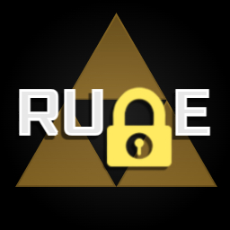
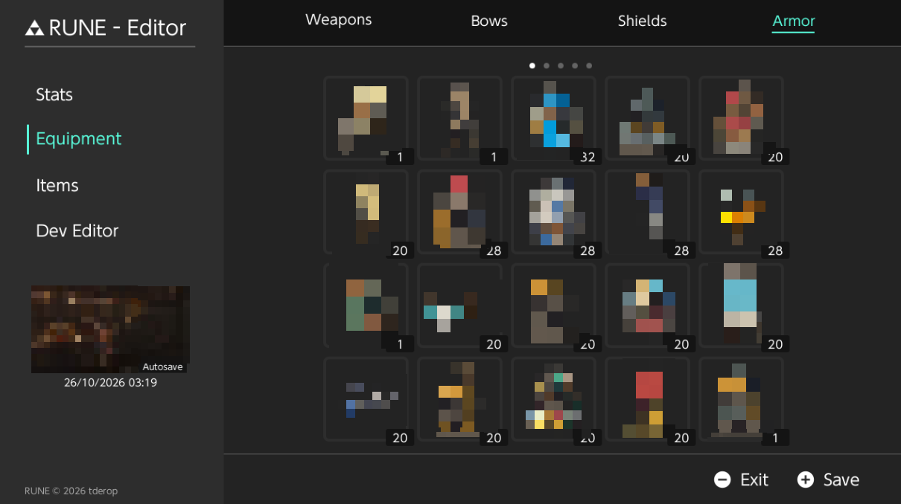
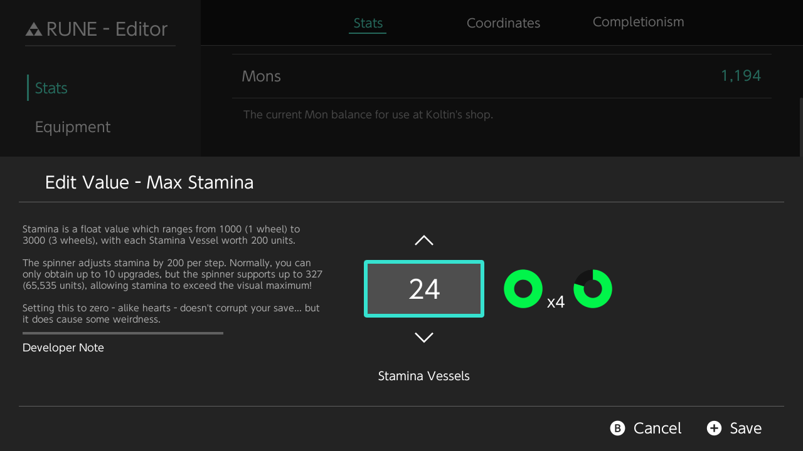
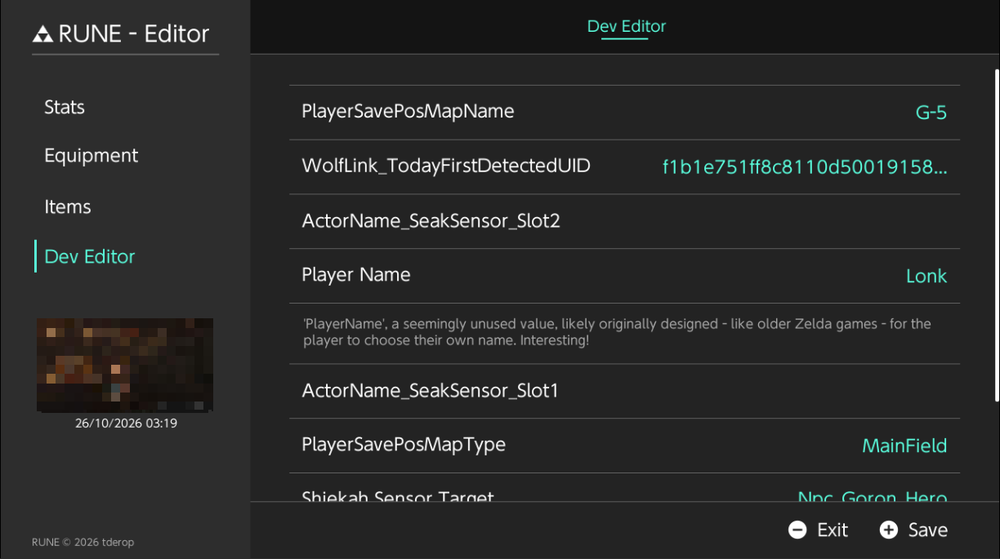

    <h1>RUNE - Native NX GUI Save Editor for BotW</h1>
    

## Overview
**RUNE** is an open source, native GUI save editor for The Legend of Zelda: Breath of the Wild on Nintendo Switch.

## Installation
> Note: Atmosphére custom firmware is required to run homebrew software like RUNE on your Nintendo Switch. For information on how to install Atmosphére, please visit [switch.hacks.guide](https://switch.hacks.guide/) and follow the guides.
1. Download the latest standalone `.nro` release of RUNE
2. Copy `RUNE.nro` to `sdmc:/switch/RUNE.nro` on your Nintendo Switch's SD card
3. Boot into Atmosphére
4. Click on a game to launch it, and hold R whilst you select a user
5. Continue holding R until the **hbmenu** appears, then select RUNE

You're now running RUNE on your Nintendo Switch!

### Why don't I see icons in RUNE?
Because of copyright law, RUNE is not allowed to redistribute content owned by Nintendo Co., Ltd., which includes the item icons you see in your inventory.  Fortunately, this doesn't mean you _can't_ have icons, it just means you need to **open RUNE in "title takeover" mode** with Breath of the WIld selected. **This takes time**, on average about 1 minute and 30 seconds. You only need to do this once.  By doing this, you give RUNE access to the files in your local Breath of the Wild installation - allowing it to extract the menu icons to your SD card. The icons are cached in `sdmc:/switch/RUNE/assets/thumb`; take a look - they're extracted from your own copy of the game! All of the icons combined should take up a total of no more than ~40MB.
 

## Screenshots
> Note: game screenshots/icon assets have been omitted/pixelated in these screenshots. RUNE features support for full resolution save slot thumbnails and item icons.

<table>
    <tr>
        <td></td>
        <td></td>
    </tr>
    <tr>
        <td></td>
        <td></td>
    </tr>
</table>

## Credits
Thanks to:
- ZeldaMods for save file information found at https://zeldamods.org/wiki/Save_Files
- MrCheeze for `actor_names.json`, a part of the botw-tools repository https://github.com/MrCheeze/botw-tools/
- Léo Lam (@leoetlino) at ZeldaMods for
    - The bymlplus library for parsing BYAML files: https://github.com/zeldamods/bymlplus
        - Required range-v3 by Eric Niebler (@ericniebler)
        - Required spdlog by Gabi Melman (@gabime)
    - oead - `oead::yaz0` source used for helping me understand the yaz0 compression format: https://github.com/zeldamods/oead
- KillzXGaming for
    - Switch Toolbox used for helping me understand the SBITEMICO format: https://github.com/KillzXGaming/Switch-Toolbox
    - BfresLibrary used for helping me understand the BFRES format: https://github.com/KillzXGaming/BfresLibrary
- Tyulis for documenting BNTX and BRTI: https://github.com/Tyulis/3DSkit/blob/master/doc/BNTX.md
- AboodXD (@aboood40091) for:
    - BNTX-Injector source https://github.com/aboood40091/BNTX-Injector ...
    - ... which also directed me to the NVIDIA Tegra X1 Mobile Processor (Technical Reference Manual) page 1215-1240 - Chapter 20: Pixel Memory Format
- tallbl0nde for the WIP Aether UI library: https://github.com/tallbl0nde/Aether
- Sean Barrett (nothings) for `stb_image_write.h` for writing PNG files to disk
- devkitPro for the devkitA64 toolchain
- switchbrew for the libnx library: https://github.com/switchbrew/libnx
- and the Atmosphére team

for making RUNE possible!

## Use of AI (Artificial Intelligence)
**RUNE was generated entirely, 100%, by HI**.  <small>human intelligence :)</small>  
Although **AI was used to assist RUNE's development process**, it was NOT involved in code generation or reverse engineering. AI was used for **debugging assistance**, **quick code reviews**, and **Makefile changes**. RUNE is not vibe coded; it was developed by hand - the "old fashioned way" - by a CS cyber student that wanted to do something with his spare time. I wouldn't have had anything to do during journeys or breaks otherwise.  <small>homework schmomework</small>   A quick look at the state of the codebase may also confirm this for the more technically advanced. **Contributions suspected to be generated by AI will be ignored.**  

## Attribution
- <a href="https://www.flaticon.com/free-icons/foursquare-check-in" title="foursquare check in icons">Foursquare check in icons created by reussy - Flaticon</a>

## Intellectual Property
RUNE © 2026 tderop (https://github.com/tderop/RUNE)

RUNE is an unofficial source-available save editor for The Legend of Zelda: Breath of the Wild.
The Legend of Zelda, its characters, trademarks, and game assets are the intellectual property of Nintendo Co., Ltd.
RUNE is not affiliated with or endorsed by Nintendo.

RUNE is free software. If you paid for this software, ask for a refund. Always download from the [official GitHub repository](https://github.com/tderop/RUNE) to obtain an authentic build.

You may use, copy, modify, and redistribute this software, provided that the software and any modified versions are distributed **free of charge**. You may not sell, sublicense, or otherwise charge a fee for the software itself or for access to the software.

---

RUNE respects the intellectual property rights of others.

If you believe that material distributed through the official RUNE repository infringes your copyright or other applicable intellectual property rights, please contact the repository owner with a sufficiently detailed notice identifying the allegedly infringing material and the basis for the claim.

Upon receiving a legitimate takedown request, I will review the claim and remove or disable access to all relevant material as soon as reasonably practicable.

I may also remove or disable access to material voluntarily where there is a reasonable basis to believe that its distribution infringes the rights of another party.

False or fraudulent takedown requests will be disregarded.

## Disclaimer
When you use RUNE, you are doing so at your own risk. RUNE and/or its contributors are **not responsible for lost or corrupted save data**. RUNE stores backups of edited `.sav` files in `sdmc:/switch/RUNE/backups` with the filename format `game_data.sav.BAK_DD.MM.YYYY_HH.MM`, the timestamp being that of when the save file was edited.